# FinSure — Phase 9A: Frontend Architecture Specification

**Status:** Completed & Verified  
**Date:** 2026-09-29  
**Version:** 1.0.0  

---

## 1. Executive Summary

Phase 9A establishes the production-grade frontend architecture for the **FinSure AI-Based Financial Fraud Detection Platform**. Built with **React 18.3.1**, **Vite 6.4.3**, **TypeScript 5.8**, and **Tailwind CSS 3.4**, this frontend foundation is engineered to interface directly with the validated Phase 1–8 backend services while adhering to strict institutional FinTech security, accessibility, and visual guidelines.

---

## 2. Technology Stack & Runtime Configuration

| Layer | Technology | Version | Purpose / Rationale |
| :--- | :--- | :--- | :--- |
| **Runtime UI** | React | 18.3.1 | Core UI library with Concurrent Mode & Suspense |
| **Bundler & Dev Server** | Vite | 6.4.3 | Instant HMR, ESM bundling, dynamic chunk code-splitting |
| **Language** | TypeScript | 5.8 | Type safety across API payloads, state, and UI props |
| **Styling** | Tailwind CSS | 3.4.17 | Utility-first CSS using semantic CSS variables |
| **Icons** | Lucide React | 0.475.0 | Clean, institutional financial iconography |
| **3D Rendering** | Three.js + React Three Fiber | 0.173.0 / 8.18.0 | Hardware-accelerated spatial views (Trinetra, Verdict Gate) |
| **Animations** | Framer Motion | 12.4.7 | Accessible motion primitives respecting reduced-motion |
| **Routing** | React Router DOM | 7.2.0 | Declarative client-side nested routing & guards |

---

## 3. Directory Layout & Module Structure

```
frontend/
├── dist/                          # Production build output
│   ├── assets/
│   │   ├── index-*.css            # Theme tokens & component utility styles (30.35 kB)
│   │   ├── index-*.js             # Core application bundle (188.67 kB)
│   │   ├── vendor-*.js            # React, React Router, Lucide vendor chunk (208.03 kB)
│   │   └── three-*.js             # Three.js / R3F isolated chunk (824.00 kB)
│   └── index.html
├── src/
│   ├── api/                       # Centralized typed API clients
│   │   ├── client.ts              # Core fetcher with Bearer auth & 401 refresh rotation
│   │   ├── auth.ts                # Auth API (login, signup, OTP, session)
│   │   ├── transactions.ts        # Real-time scoring, challenge verify, feedback
│   │   ├── incidents.ts           # Incident lifecycle, replay, audit notes
│   │   ├── alerts.ts              # Alert queue triage & analyst assignment
│   │   ├── cases.ts               # Case workspace & evidence pack exports
│   │   ├── reports.ts             # Customer & regulatory STR/SAR reporting
│   │   └── health.ts              # System telemetry & model registry health
│   ├── components/
│   │   ├── 3d/                    # 3D spatial boundary & 2D fallbacks
│   │   │   ├── FinSureCanvas.tsx  # WebGL detection & canvas lifecycle
│   │   │   ├── Fallback2DView.tsx # Accessible tabular equivalent
│   │   │   ├── TrinetraPreview.tsx# 3D ego-network graph preview
│   │   │   ├── VerdictGatePreview.tsx # 4-model ensemble flow preview
│   │   │   ├── ThreatGlobePreview.tsx # UPI geographic velocity preview
│   │   │   └── index.ts
│   │   ├── layout/                # Application shells & guards
│   │   │   ├── Logo.tsx           # Institutional shield & wordmark
│   │   │   ├── Sidebar.tsx        # Collapsible responsive navigation
│   │   │   ├── Topbar.tsx         # Header, theme switch, 3D toggle, session
│   │   │   ├── ProtectedRoute.tsx # Authentication gate
│   │   │   ├── RoleGuard.tsx      # RBAC permission gate
│   │   │   └── index.ts
│   │   └── ui/                    # 30 Reusable FinTech Design System Components
│   ├── context/                   # Global state providers
│   │   ├── AuthContext.tsx        # Session hydration, login, signup, token lifecycle
│   │   └── ThemeContext.tsx       # Dark/Light theme, 3D enable/disable, reduced-motion
│   ├── layouts/                   # Role-specific layouts
│   │   ├── PublicLayout.tsx       # Institutional marketing & authentication shell
│   │   ├── CustomerLayout.tsx     # Account holder banking shell
│   │   ├── AnalystLayout.tsx      # Fraud analyst command center shell
│   │   └── AdminLayout.tsx        # System administration & ML ops shell
│   ├── mocks/                     # Isolated synthetic development datasets
│   │   ├── mockData.ts            # Synthetic transactions, alerts, metrics (IS_MOCK_DATA=true)
│   │   └── MockDisclaimerBanner.tsx
│   ├── pages/                     # Routed views (Foundational / Wireframe states)
│   │   ├── public/                # Landing, Login, Signup, OTP, ForgotPassword, ResetPassword
│   │   ├── customer/              # Dashboard, Transactions, TxnDetail, Security, Payees, Reports
│   │   ├── analyst/               # Dashboard, Alerts, IncidentDetail, Cases, CaseDetail, Replay, Rings, Reports
│   │   ├── admin/                 # Dashboard, Users, Models, Policies, Audit, System
│   │   └── NotFoundPage.tsx       # 404 Route handler
│   ├── styles/
│   │   └── index.css              # Design tokens (CSS variables), typography, custom scrollbars
│   ├── types/                     # Strongly-typed domain interfaces
│   │   ├── common.ts              # Role, Priority, Decision, Error, Pagination
│   │   ├── auth.ts                # User, AuthTokens, LoginRequest, SignupRequest
│   │   ├── transaction.ts         # TransactionPayload, ScoreResponse, ShapReason
│   │   ├── incident.ts            # Incident, IncidentEvent, IncidentNote, ReplayResponse
│   │   └── case.ts                # Case, CaseEvidence, CaseTransition, InvestigationRun
│   ├── router.tsx                 # React Router v7 configuration
│   ├── App.tsx                    # Context Provider hierarchy
│   ├── main.tsx                   # DOM entrypoint
│   └── vite-env.d.ts              # Vite client types
├── tailwind.config.js             # Token definitions & responsive breakpoints
├── tsconfig.json                  # Path aliases (@/*), strict mode
└── vite.config.ts                 # Dev proxy (/api -> localhost:8000), manual chunk splitting
```

---

## 4. Routing & Role-Based Access Control Architecture

The routing topology is segregated into four distinct role tiers:

```mermaid
flowchart TD
    Router["Client Router (createBrowserRouter)"]
    Router --> PublicBranch["/ (PublicLayout)"]
    Router --> CustomerBranch["/customer (CustomerLayout)"]
    Router --> AnalystBranch["/analyst (AnalystLayout)"]
    Router --> AdminBranch["/admin (AdminLayout)"]

    PublicBranch --> Landing["/ (LandingPage)"]
    PublicBranch --> Login["/login (LoginPage)"]
    PublicBranch --> Signup["/signup (SignupPage)"]
    PublicBranch --> OTP["/verify-otp (VerifyOtpPage)"]
    PublicBranch --> Forgot["/forgot-password"]
    PublicBranch --> Reset["/reset-password"]

    CustomerBranch --> ProtCust["ProtectedRoute + RoleGuard(['customer', ...])"]
    ProtCust --> CustDash["/customer (Overview)"]
    ProtCust --> CustTxns["/customer/transactions"]
    ProtCust --> CustDetail["/customer/transactions/:id"]
    ProtCust --> CustPayees["/customer/payees"]
    ProtCust --> CustSec["/customer/security"]
    ProtCust --> CustRep["/customer/reports"]

    AnalystBranch --> ProtAnalyst["ProtectedRoute + RoleGuard(['fraud_analyst', 'compliance_officer', 'admin'])"]
    ProtAnalyst --> AnalDash["/analyst (Command Center)"]
    ProtAnalyst --> AnalAlerts["/analyst/alerts (Alert Queue)"]
    ProtAnalyst --> AnalInc["/analyst/incidents/:id"]
    ProtAnalyst --> AnalCases["/analyst/cases & :id"]
    ProtAnalyst --> AnalRings["/analyst/rings (Trinetra)"]
    ProtAnalyst --> AnalReplay["/analyst/replay (Threat Replay)"]
    ProtAnalyst --> AnalRep["/analyst/reports (STR/SAR)"]

    AdminBranch --> ProtAdmin["ProtectedRoute + RoleGuard(['admin'])"]
    ProtAdmin --> AdminDash["/admin (System Overview)"]
    ProtAdmin --> AdminUsers["/admin/users (RBAC)"]
    ProtAdmin --> AdminModels["/admin/models (Model Registry)"]
    ProtAdmin --> AdminPol["/admin/policies (Operating Thresholds)"]
    ProtAdmin --> AdminAudit["/admin/audit (SHA-256 Chain)"]
    ProtAdmin --> AdminSys["/admin/system (Telemetry)"]
```



---

## 5. API Client & Authentication Layer

### 5.1 Bearer Token & Automatic 401 Rotation
The centralized `apiClient` in `frontend/src/api/client.ts`:
1. Injects `Authorization: Bearer <access_token>` into outbound requests.
2. Injects `X-Request-ID` correlation identifiers.
3. Automatically catches `401 Unauthorized` responses and pauses subsequent requests in a subscriber queue.
4. Executes atomic refresh via `POST /api/v1/auth/refresh` using the stored refresh token.
5. If the refresh succeeds, updates access/refresh tokens in storage and replays queued requests.
6. If the refresh token is revoked or replay-attacked, clears session tokens and emits `finsure:session-expired` to safely log the user out without application crashes.

---

## 6. 3D Architectural Boundary & Accessibility

FinSure strictly enforces that **3D is purposeful, not decorative**:
- **WebGL Capability Detection:** `isWebGLAvailable()` tests whether the browser supports `webgl` or `webgl2`.
- **User Preference Detection:** `prefers-reduced-motion` is detected automatically and exposed via `useTheme()`.
- **Global 3D Toggle:** Users can switch between 3D Spatial rendering and 2D Tabular rendering at any time from the Topbar or within individual canvas containers.
- **Fail-Safe Fallback:** If WebGL fails, context is lost, or 3D is disabled, `Fallback2DView` renders identical data in an accessible tabular/text format. No data is hidden behind 3D interactions.
