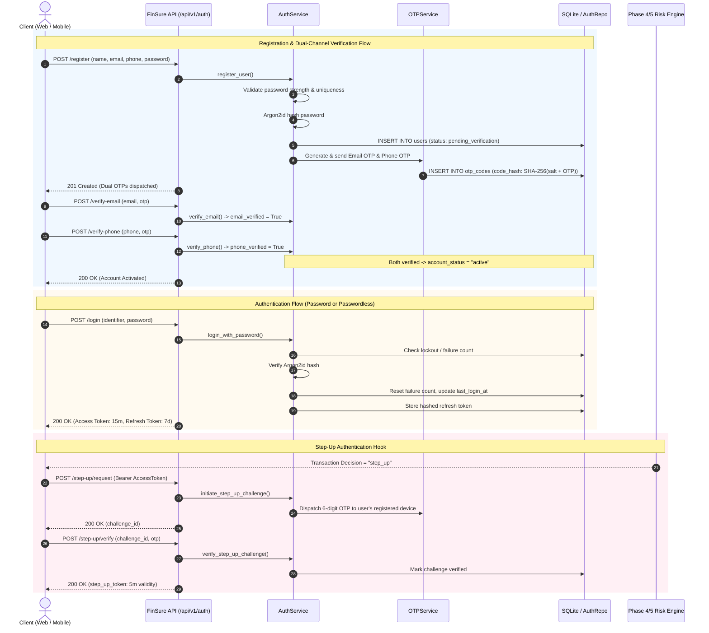

# FinSure Authentication & Authorization Architecture

## 1. Overview
FinSure provides a zero-trust, multi-factor authentication and session management architecture designed for Indian digital payment systems (UPI) and high-consequence financial applications.

The authentication subsystem enforces:
1. **Dual-Channel Verification**: Mandatory email and phone verification via cryptographically secure single-use OTPs before an account transitions from `pending_verification` to `active`.
2. **Argon2id Password Security**: Password hashing parameterized to exceed OWASP standards, resistant to GPU/ASIC brute-force and side-channel timing attacks.
3. **Passwordless OTP Login**: Direct numeric code verification for seamless, credential-stuffing resistant customer authentication.
4. **RFC 7519 JWT Session Lifecycle**: Short-lived (15-minute) non-PII access tokens paired with persistently tracked, cryptographically rotated, long-lived (7-day) refresh tokens.
5. **Step-Up Authentication (2FA)**: Native integration with the Phase 4/5 Real-Time Fraud Decision Engine, issuing short-lived (5-minute) authorization tokens upon step-up verification.
6. **Immutable Audit Trail**: Append-only security audit log capturing every authentication event, lockout, and permission check.

---

## 2. Authentication Lifecycle



---

## 3. Cryptographic Specification

### 3.1 Argon2id Password Hashing
FinSure exclusively uses `Argon2id` (RFC 9106), the winner of the Password Hashing Competition. Plaintext passwords never touch disk or logs, and candidate verification runs in constant time.

| Parameter | Value | Rationale |
|:---|:---|:---|
| **Variant** | `Argon2id` | Hybrid of Argon2i (data-independent) and Argon2d (data-dependent); mitigates both side-channel and GPU cache-timing attacks. |
| **Time Cost ($t$)** | `2` iterations | Enforces minimum compute cost while maintaining < 150 ms login latency. |
| **Memory Cost ($m$)** | `65,536` KiB (64 MiB) | High memory-hardness renders parallel GPU/ASIC dictionary attacks computationally infeasible. |
| **Parallelism ($p$)** | `4` threads | Matches multi-core modern server CPU topology. |
| **Hash Length** | `32` bytes (256 bits) | High-entropy output digest. |
| **Salt Length** | `16` bytes (128 bits) | Cryptographically random unique salt per password via CSPRNG (`os.urandom`). |

### 3.2 Password Policy & Complexity
Passes strict regex inspection:
- Minimum length: 8 characters
- At least 1 uppercase letter (`[A-Z]`)
- At least 1 lowercase letter (`[a-z]`)
- At least 1 numeric digit (`[0-9]`)
- At least 1 special character (`[\W_]`)
- Rejection of common/breached passwords (`password123`, `admin123!`, `12345678`, etc.)

---

## 4. OTP Subsystem Architecture

FinSure provides a dedicated, cryptographically isolated OTP subsystem:
1. **Generation**: Generated using Python's `secrets.randbelow()` (operating-system cryptographically secure pseudo-random number generator `CryptGenRandom`/`/dev/urandom`), producing a 6-digit code in the range `100000` to `999999`.
2. **Storage At-Rest**: Plaintext OTP is **never stored**. The database stores only:
   $$\text{code\_hash} = \text{SHA-256}(\text{salt} \parallel \text{otp})$$
3. **Expiration**: Strict 5-minute (300-second) window. Any OTP submitted at $t > t_{\text{created}} + 300\text{s}$ is rejected.
4. **Single-Use Invalidation**: Once verified successfully, `used_at` timestamp is written. Any subsequent attempt with the same OTP fails.
5. **Brute-Force Guard**: Maximum 5 attempts allowed per OTP record. The 6th attempt is blocked, and the OTP is permanently invalidated.
6. **Resend Cooldown**: Enforces a strict 60-second cooldown per identifier and purpose. Rapid re-requests return HTTP `429 Too Many Requests`.
7. **Safe Test Delivery Adapter**: Pluggable `NotificationAdapter` abstraction. In automated test and development environments, OTPs are routed to an in-memory outbox, strictly forbidding raw OTPs from leaking into production console logs or API responses.

---

## 5. Token & Session Management

### 5.1 Access Tokens
- **Format**: RFC 7519 JSON Web Token (JWT).
- **Algorithm**: HMAC-SHA256 (`HS256`) with a 256-bit minimum secret key conforming to RFC 7518 Section 3.2.
- **Validity**: 15 minutes.
- **Claims**:
  ```json
  {
    "sub": "usr_7a4b1c8e2f90",
    "role": "customer",
    "type": "access",
    "jti": "acc_09f3e4a2bc1d",
    "iat": 1759104000,
    "exp": 1759104900
  }
  ```
- **Zero Sensitive PII**: No email, phone, name, or password hashes are embedded in the access token.

### 5.2 Refresh Tokens & Token Rotation
- **Format**: Signed JWT with `type="refresh"`.
- **Validity**: 7 days.
- **Database Tracking**: Persistent table storing `(jti, user_id, token_hash, device_id, expires_at, revoked_at)`.
- **Rotation**: Calling `POST /api/v1/auth/refresh` consumes the old refresh token, immediately marks it as `revoked_at = now`, and issues a new access token AND a new rotated refresh token.
- **Reuse Detection & Replay Defense**: If an already revoked refresh token is presented, the system detects a token hijacking attack, immediately revokes **all** active sessions for that `user_id`, and logs a critical security alert.
- **Logout**: Calling `POST /api/v1/auth/logout` sets `revoked_at = now` on the refresh token.

### 5.3 Step-Up Authorization Tokens
- **Format**: Signed JWT with `type="step_up"`.
- **Validity**: 5 minutes.
- **Claims**: `sub`, `challenge_id`, `type="step_up"`, `jti`, `iat`, `exp`.
- **Purpose**: Authorizes completion of transactions flagged as `step_up` by the Phase 4/5 Risk Decision Engine.

---

## 6. Database Schema (SQLite / PostgreSQL Compatible)

```sql
-- Users table
CREATE TABLE users (
    user_id TEXT PRIMARY KEY,
    full_name TEXT NOT NULL,
    email TEXT UNIQUE NOT NULL,
    phone TEXT UNIQUE NOT NULL,
    password_hash TEXT NOT NULL,
    role TEXT NOT NULL DEFAULT 'customer',
    email_verified INTEGER NOT NULL DEFAULT 0,
    phone_verified INTEGER NOT NULL DEFAULT 0,
    account_status TEXT NOT NULL DEFAULT 'pending_verification',
    failed_login_count INTEGER NOT NULL DEFAULT 0,
    locked_until TEXT,
    created_at TEXT NOT NULL,
    updated_at TEXT NOT NULL,
    last_login_at TEXT
);

-- OTP verification codes table (hashed storage)
CREATE TABLE otp_codes (
    otp_id TEXT PRIMARY KEY,
    user_id TEXT,
    identifier TEXT NOT NULL,
    channel TEXT NOT NULL,
    purpose TEXT NOT NULL,
    code_hash TEXT NOT NULL,
    salt TEXT NOT NULL,
    attempts INTEGER NOT NULL DEFAULT 0,
    max_attempts INTEGER NOT NULL DEFAULT 5,
    expires_at TEXT NOT NULL,
    used_at TEXT,
    created_at TEXT NOT NULL
);

-- Refresh tokens table (rotation and revocation tracking)
CREATE TABLE refresh_tokens (
    jti TEXT PRIMARY KEY,
    user_id TEXT NOT NULL,
    token_hash TEXT NOT NULL,
    device_id TEXT,
    expires_at TEXT NOT NULL,
    revoked_at TEXT,
    created_at TEXT NOT NULL,
    FOREIGN KEY (user_id) REFERENCES users(user_id)
);

-- Step-up challenges table
CREATE TABLE step_up_challenges (
    challenge_id TEXT PRIMARY KEY,
    user_id TEXT NOT NULL,
    transaction_id TEXT,
    otp_id TEXT NOT NULL,
    verified INTEGER NOT NULL DEFAULT 0,
    expires_at TEXT NOT NULL,
    created_at TEXT NOT NULL,
    FOREIGN KEY (user_id) REFERENCES users(user_id)
);

-- Immutable security audit log table
CREATE TABLE auth_audit_logs (
    id INTEGER PRIMARY KEY AUTOINCREMENT,
    event_id TEXT NOT NULL UNIQUE,
    actor_id TEXT,
    event_type TEXT NOT NULL,
    channel TEXT,
    status TEXT NOT NULL,
    ip_address TEXT,
    request_id TEXT,
    reason_category TEXT,
    metadata_json TEXT,
    timestamp TEXT NOT NULL
);
```
