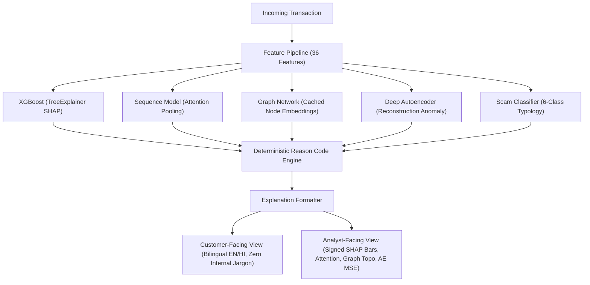

# FinSure Explainability & Reason Code Catalogue

**Specification Version:** `v1.0.0`  
**Effective Date:** 2026-09-28  
**Applicability:** Customer Communications, Fraud Analyst Workbench, Threat Replay Engine  
**Governing Standard:** IEEE 830 / FinSure SRS v2 Section 3.3 (FR-ML-03)

---

## 1. Multi-Modal Explainability Architecture

FinSure provides transparent, evidence-backed explanations by decomposing risk into multi-modal components:

---

## 2. Canonical Reason Code Catalogue

FinSure defines **10 deterministic, canonical reason codes** evaluated in strict priority order.

### Table of Canonical Reason Codes

| Priority | Reason Code | Deterministic Trigger Rule | English Description | Hindi Description |
|:---:|---|---|---|---|
| **1** | `RC_AMOUNT_ANOMALY` | `amt_user_zscore >= 3.0` OR `amt_to_user_mean >= 5.0` OR (`amount > 20000` AND `amt_to_user_mean >= 3.0`) | Transaction amount is significantly higher than your typical spending pattern. | यह लेन-देन राशि आपके सामान्य खर्च पैटर्न से काफी अधिक है। |
| **2** | `RC_RAPID_VELOCITY` | `txn_count_1m >= 1` OR `txn_count_1h >= 4` OR `rapid_burst == 1` | Multiple payments attempted in an unusually short time frame. | बहुत कम समय अंतराल में कई लेन-देन का प्रयास किया गया है। |
| **3** | `RC_NEW_DEVICE` | `is_new_device == 1` | Payment initiated from a newly observed device or one associated with multiple accounts. | यह भुगतान एक नए या अज्ञात डिवाइस से शुरू किया गया है। |
| **4** | `RC_OFF_HOURS` | `is_night == 1` AND (`amount >= 5000` OR `is_new_payee == 1`) | High-value payment attempted during late night or early morning hours. | देर रात या असामान्य समय पर बड़ा लेन-देन करने का प्रयास किया गया। |
| **5** | `RC_GRAPH_RISK` | Device linked to $>1$ distinct user OR Payee in-degree $\ge 5$ distinct senders | Device or payment endpoint shows multiple conflicting linkages in the entity network. | भुगतान डिवाइस या खाता नेटवर्क में कई संदेहास्पद संबंधों से जुड़ा पाया गया है। |
| **6** | `RC_SEQUENCE_ANOMALY` | Sequence top-attended step weight $\ge 0.30$ AND `rapid_burst == 1` | Transaction sequence shows characteristics of rapid account draining or testing. | हालिया लेन-देन का क्रम त्वरित निकासी या परीक्षण गतिविधियों जैसा है। |
| **7** | `RC_RECONSTRUCTION_OUTLIER` | Autoencoder MSE $> 0.3418$ (Frozen Zero-Day Threshold) | Transaction pattern strongly deviates from established baseline behavior (zero-day anomaly). | यह लेन-देन स्थापित सामान्य बैंकिंग व्यवहार से काफी अलग है। |
| **8** | `RC_BENEFICIARY_RISK` | `is_new_payee == 1` | Transfer directed to a newly created or unfamiliar beneficiary VPA. | यह भुगतान एक नए या अपरिचित लाभार्थी खाते (VPA) को भेजा जा रहा है। |
| **9** | `RC_GEO_MISMATCH` | `impossible_travel == 1` OR (`is_out_of_home_city == 1` AND `implied_travel_speed_kmh > 250`) | Transaction location is inconsistent with recent physical movement or home location. | लेन-देन का स्थान हालिया गतिविधि या आपके पंजीकृत स्थान से मेल नहीं खाता। |
| **10** | `RC_HIGH_VALUE_FIRST_TIME` | `is_new_payee == 1` AND `amount >= 10000.0` | Large monetary sum transferred to a recipient for the very first time. | पहली बार किसी लाभार्थी को एक बड़ी धनराशि ट्रांसफर की जा रही है। |

---

## 3. Strict Audience Isolation Rules

### 3.1 Customer-Facing Communication Rules
1. **Zero Technical Jargon:** Never use terms such as `SHAP`, `zscore`, `TreeExplainer`, `Autoencoder`, `GraphSAGE`, `MSE`, `latent dimension`, or numerical feature weights.
2. **Reassuring and Non-Alarmist:** Language must explain the protective intent (e.g., "For your security", "To protect your account").
3. **Actionable Instructions:** Always provide next steps (e.g., "Enter OTP", "2-hour security hold", "Contact 24/7 bank support").
4. **Bilingual Requirement:** Customer notifications are available natively in English (`en`) and Hindi (`hi`).

### 3.2 Analyst-Facing Communication Rules
1. **Full Mathematical Transparency:** Expose exact base value, signed SHAP contributions (+ red for risk-increasing, - green for risk-reducing), and exact feature magnitudes.
2. **Non-Causal Sequence Description:** Attention weights must be described as temporal relevance in the neural sequence encoder, never as proven historical cause.
3. **Graph Topology Evidence:** Report actual node IDs (`user:USR_...`, `payee:...`, `device:...`), degree counts, and cache hits.
4. **Zero-Day Diagnostics:** Report reconstruction MSE relative to the certified frozen validation threshold ($0.3418$) and identify top anomalous feature dimensions.
5. **Scam Typology:** Display multi-task predicted scam category (e.g., `account_takeover`, `mule_account`) and classifier confidence.
