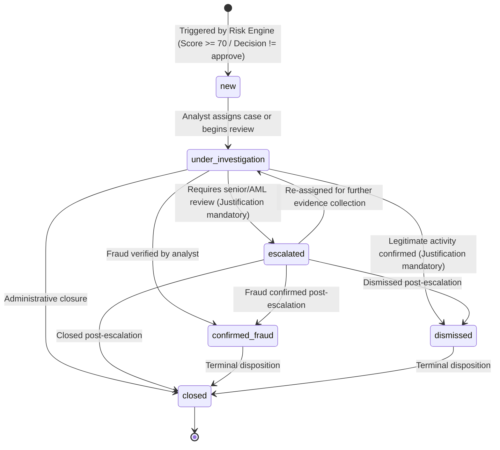

# FinSure Incident State Machine Specification

## 1. Overview
In FinSure, an **Incident** represents an automated or investigator-initiated fraud investigation case triggered by high-risk transaction scoring, anomaly thresholds, or manual analyst escalation.

> [!IMPORTANT]
> **Core Policy Principle:** An AI model risk score, probability, or decision is an **algorithmic risk estimate** and **NEVER legal or factual confirmation of fraud**. The transition to `confirmed_fraud` or `dismissed` requires independent human investigator verification.

---

## 2. State Machine Diagram

---

## 3. Allowed Transition Matrix

| Source State | Target State | Permitted Roles | Mandatory Requirements |
|:---|:---|:---|:---|
| `new` | `under_investigation` | `fraud_analyst`, `analyst`, `admin` | Analyst assignment / investigation opened. |
| `under_investigation` | `escalated` | `fraud_analyst`, `analyst`, `admin` | Mandatory non-empty `reason` string explaining escalation rationale (e.g. mule ring tie, organized fraud syndicate link). |
| `under_investigation` | `confirmed_fraud` | `fraud_analyst`, `analyst`, `admin` | Verification notes and evidence reference. |
| `under_investigation` | `dismissed` | `fraud_analyst`, `analyst`, `admin`, `compliance_officer` | Mandatory non-empty `reason` string. **Elevated Authorization Rule:** Dismissal of `CRITICAL` priority incidents (Risk Score $\ge 90$ or Block decision) **strictly requires `admin` or `compliance_officer` authorization**. |
| `under_investigation` | `closed` | `fraud_analyst`, `analyst`, `admin` | Closure summary notes. |
| `escalated` | `under_investigation` | `fraud_analyst`, `analyst`, `admin` | Reversion reason notes. |
| `escalated` | `confirmed_fraud` | `fraud_analyst`, `analyst`, `admin` | Documented fraud findings. |
| `escalated` | `dismissed` | `admin`, `compliance_officer` | Executive justification. |
| `escalated` | `closed` | `admin`, `compliance_officer` | Comprehensive case report. |
| `confirmed_fraud` | `closed` | `fraud_analyst`, `analyst`, `admin` | Recovery / reporting complete. |
| `dismissed` | `closed` | `fraud_analyst`, `analyst`, `admin` | Case archiving. |

Any state transition not listed above (e.g., `new` $\to$ `closed`, `closed` $\to$ `under_investigation`, `confirmed_fraud` $\to$ `under_investigation`) is **illegal** and rejected with HTTP `400 Bad Request`.

---

## 4. Cryptographic Hash-Chain Event Logging

Every valid state transition automatically appends a block to the incident's immutable cryptographic ledger:

$$\text{record\_hash} = \text{SHA-256}(\text{event\_id} \parallel \text{incident\_id} \parallel \text{event\_type} \parallel \text{actor\_id} \parallel \text{timestamp} \parallel \text{payload} \parallel \text{previous\_hash})$$

- **Genesis Block**: The incident creation event binds to $\text{previous\_hash} = 0^{64}$.
- **Immutability**: Historical events cannot be edited or deleted. If an error occurred, a compensating event is appended to the chain.
- **Verification**: Any gap, truncation, or modification breaks the cryptographic linkage and is detected by `verify_incident_event_chain()`.
