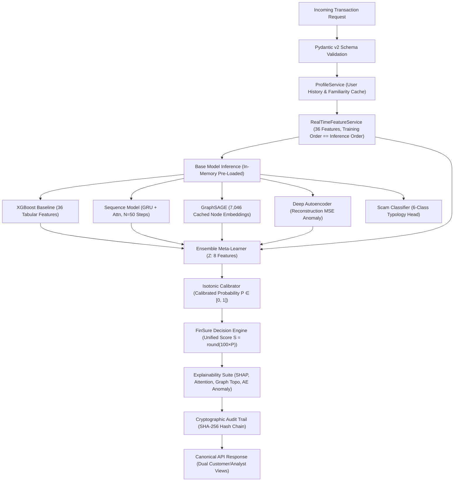

# FinSure Real-Time Model Serving Architecture

**Architecture Version:** `v1.0.0`  
**Effective Date:** 2026-09-28  
**Governing Standard:** IEEE 830 / FinSure SRS v2 / Master Prompt v2 Section 5 & 8  
**Target Latency:** $P_{95} < 100\text{ ms}$

---

## 1. Overview & Serving Topology

The FinSure model serving pipeline is designed for high-throughput, low-latency scoring on live banking rails. All models and preprocessors are loaded once into memory during the application startup lifespan.

---

## 2. Model Lifecycle & Pre-Loading Strategy

1. **Lifespan Startup (`ModelRegistry`):**
   - All 9 model artifacts (`xgboost_baseline.json`, `sequence_model.pt`, `graph_model.pt`, `cached_embeddings.joblib`, `autoencoder.pt`, `scam_classifier.pt`, `ensemble_meta_learner.joblib`, `feature_scaler.joblib`, `risk_thresholds.yaml`) are loaded into memory when the server boots.
   - **Zero Per-Request Reload:** Model weights are resident in memory; requests never trigger disk I/O to read models.
2. **Fail-Fast Integrity Verification:**
   - If any required model artifact is missing or corrupted at startup, `ModelRegistry.load_all_artifacts()` raises `FileNotFoundError` immediately, halting deployment.
   - The system **never** substitutes fake models or returns fabricated dummy probabilities.
3. **Pre-Warming Routine:**
   - Executes a dummy forward pass through all neural models and tree structures during boot. This primes PyTorch thread pools, memory allocators, and SHAP tree representations before live client traffic is received.

---

## 3. Feature Pipeline Consistency Guarantee

A common cause of production failure in fraud detection is feature misalignment between training and serving. FinSure eliminates this risk:
1. **Identical Column Order:** The serving feature vector strictly follows `FEATURE_COLUMNS` defined in `ml/features/pipeline.py`.
2. **Explicit Dimension Check:** `RealTimeFeatureService` asserts that the output vector has exactly 36 elements and contains zero `NaN` or `Inf` values.
3. **Shared Preprocessors:** Uses the exact `feature_scaler.joblib` fitted in Phase 2 for all neural network inputs.

---

## 4. Cold-Start & Entity Handling

### 4.1 Sequence Model ($N = 50$)
- **Target Exclusion:** The current transaction being evaluated is **strictly excluded** from the historical sequence window to prevent lookahead leakage.
- **Under-50 History:** If a user has fewer than 50 past transactions (e.g. 5 transactions), the sequence is padded with zeros up to length 50, and the attention mask is set to `False` for all padded steps.
- **Zero History (First-Time User):** Padded completely with zeros. Attention weights return uniform representation without crashing, and the analyst narrative clearly notes: *"No prior transaction history available for this account."*

### 4.2 GraphSAGE & Entity Embeddings
- **Cached Embeddings:** 7,046 verified node representations are loaded into memory (`u_key`, `p_key`, `d_key`).
- **Unseen Entities:** If a user, payee, or device is not present in the graph cache, the serving service supplies a neutral zero embedding vector ($32\text{ dims}$) and flags the entity as unfamiliar. Inference executes seamlessly in $< 1\text{ ms}$.
- **Known Limitation:** The current node embedding cache is static (bounded at Day 60). In Phase 10 (MLOps), an incremental graph embedding updater will refresh node embeddings.

---

## 5. Resilient State Layer (Redis with In-Memory Fallback)

1. **State Management:** `ProfileService` tracks user baseline metrics, rolling transaction history, and familiarity sets.
2. **Redis Integration:** Connects to Redis via `REDIS_URL` if configured.
3. **Resilient Fallback:** If Redis is disconnected, unavailable, or encounters a socket timeout, `ProfileService` automatically transitions to in-memory dictionaries without dropping requests or throwing 500 errors.
4. **Audit Durability:** Decision audit records are chained via SHA-256 and stored in an append-only in-memory ledger with automated disk flushing capabilities.
