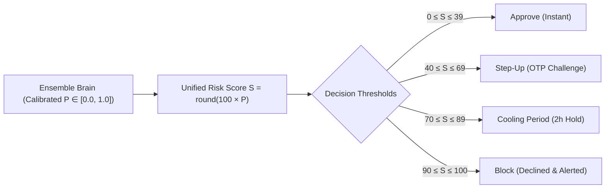

# FinSure Risk Scoring & Decision Contract Specification

**Document Version:** `v1.0.0`  
**Effective Date:** 2026-09-28  
**Status:** Approved & Frozen for Serving  
**Governing Standard:** IEEE 830 / FinSure SRS v2 (FR-ML-01, FR-ML-03) / Master Prompt v2 Section 6

---

## 1. Executive Overview

The FinSure Risk Decision Engine standardizes fraud risk quantification across all upstream models and operational channels. It enforces a strict, deterministic contract transforming continuous calibrated fraud probabilities into an integer risk score $S \in [0, 100]$, mapped unambiguously to operational interventions.



---

## 2. Canonical Risk Scoring Contract

### 2.1 Mathematical Formulation

1. **Model Calibration**: Upstream ensemble predictions from the Meta-Learner are calibrated using Isotonic Regression fitted strictly on validation predictions:
   $$P = \text{Calibrator}(Z) \in [0.0, 1.0]$$
2. **Unified Risk Score**:
   $$S = \text{clip}\left(\left\lfloor 100 \times P + 0.5 \right\rfloor, 0, 100\right) \in \{0, 1, 2, \dots, 100\}$$

### 2.2 Band & Action Mapping Matrix

| Risk Score ($S$) | Risk Band | Brand Badge Color | Action Key | Operational Meaning | Friction Type |
|---|---|---|---|---|---|
| **0 – 39** | `low` | `#13A89E` (Teal) | `approve` | Low risk; instant frictionless processing. | Zero friction |
| **40 – 69** | `medium` | `#E8A33D` (Amber) | `step_up` | Medium risk; step-up authentication challenge. | Verified OTP challenge |
| **70 – 89** | `high` | `#EA580C` (Orange) | `cooling_period` | High risk; 2-hour delay on unfamiliar/high-value payees. | Temporary security hold |
| **90 – 100** | `critical` | `#D64545` (Red) | `block` | Critical risk; payment blocked immediately. | Hard block + SMS/alert |

---

## 3. Canonical Decision Output Schema

Every transaction scored by `FinSureDecisionEngine` emits a validated JSON payload adhering to this schema:

```json
{
  "$schema": "http://json-schema.org/draft-07/schema#",
  "title": "FinSureRiskDecisionContract",
  "type": "object",
  "required": [
    "transaction_id",
    "timestamp",
    "calibrated_probability",
    "risk_score",
    "risk_band",
    "action",
    "policy_version",
    "reason_codes",
    "explanation"
  ],
  "properties": {
    "transaction_id": { "type": "string" },
    "timestamp": { "type": "string", "format": "date-time" },
    "calibrated_probability": { "type": "number", "minimum": 0.0, "maximum": 1.0 },
    "risk_score": { "type": "integer", "minimum": 0, "maximum": 100 },
    "risk_band": { "type": "string", "enum": ["low", "medium", "high", "critical"] },
    "risk_label": { "type": "string" },
    "badge_color": { "type": "string" },
    "action": { "type": "string", "enum": ["approve", "step_up", "cooling_period", "block"] },
    "action_description": { "type": "string" },
    "is_overridden": { "type": "boolean" },
    "policy_version": { "type": "string" },
    "cost_parameters": {
      "type": "object",
      "properties": {
        "avg_fraud_loss_inr": { "type": "number" },
        "friction_cost_inr": { "type": "number" }
      }
    },
    "reason_codes": {
      "type": "array",
      "items": { "type": "string" }
    },
    "explanation": {
      "type": "object",
      "properties": {
        "customer_facing": { "type": "object" },
        "analyst_facing": { "type": "object" }
      }
    }
  }
}
```

---

## 4. Policy Versioning & Immutability Rules

1. **Version Tagging**: Every decision record includes the governing policy version (`policy_version`, e.g., `v1.0.0`).
2. **Audit Logging**: Any update to `configs/risk_thresholds.yaml` requires an incremented semantic version (`v1.1.0`), approval by the Risk Analytics Committee, and a re-verification run of the What-If Simulator.
3. **No Dynamic Test Re-tuning**: Threshold policies cannot be modified dynamically based on test sets or incoming live traffic without an offline validation governance cycle.
