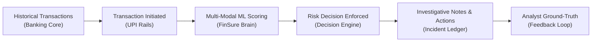

# FinSure Threat Replay Architecture & Methodology

## 1. Overview
The **Threat Replay Engine** provides an interactive forensic timeline of events leading up to, during, and after an anomalous transaction. It reconstructs the end-to-end incident lifecycle for fraud analysts, compliance officers, and judicial review.

---

## 2. Replay Sequence Construction



The replay sequence combines:
1. **Historical Pre-Transaction Events**: Prior transactions in the customer's behavioral baseline window (e.g. 1 hour before, 30 minutes before), extracted from the immutable scoring snapshot.
2. **Transaction Initiation Event**: The exact timestamp, amount, payee VPA, and device fingerprint of the evaluated transfer.
3. **ML Scoring & Decision Event**: Model execution timestamp, ensemble calibrated fraud probability, 0-100 risk score, risk band, and enforced action (`approve`, `flag`, `step_up`, `block`).
4. **Forensic Ledger Events**: Subsequent chronological investigator actions, note submissions, status transitions, and ground-truth feedback recorded in the append-only ledger.

---

## 3. Engineering Integrity Rules

### 3.1 Strict Zero-Fabrication Rule
- **NEVER Synthesize Missing Events**: Replay reflects only real events captured by the banking core, device telemetry, ML inference engine, or incident ledger.
- If an intermediate event (e.g., login, device registration) was not captured in the system record at scoring time, the engine **must not invent it**. Unrecorded events are omitted or explicitly marked `unavailable`.
- Every event carries `is_synthesized: false`.

### 3.2 Explicit Risk Attribution Labeling
> [!CAUTION]
> **Attribution Integrity:** The multi-modal ensemble evaluates risk **at transaction inference time**. Historical events preceding the transaction (such as routine coffee payments or profile lookups) were evaluated under their own historical context or not evaluated at all.

To prevent misrepresenting historical model behavior:
- All events preceding the final scoring event are strictly labeled:
  $$\text{risk\_attribution} = \text{"Final-decision attribution (Historical context)"}$$
- The scoring event itself is labeled:
  $$\text{risk\_attribution} = \text{"Recorded scoring snapshot"}$$
- The replay response payload includes a mandatory attribution disclaimer:
  > *"Earlier chronological steps reflect 'Final-decision attribution'. The ML ensemble evaluated the state at transaction scoring time; risk scores are not retroactively implied for prior historical baseline events."*

---

## 4. API Specification

### Endpoint: `GET /api/v1/incidents/{incident_id}/replay`
- **Authorization**: `fraud_analyst`, `analyst`, `compliance_officer`, `admin`.
- **Response Format**:
```json
{
  "incident_id": "inc_9915",
  "transaction_id": "TXN_9915",
  "user_id": "usr_alice",
  "risk_score": 82.0,
  "decision": "block",
  "total_events": 4,
  "attribution_notice": "IMPORTANT: Earlier chronological steps reflect 'Final-decision attribution'...",
  "events": [
    {
      "sequence_index": 1,
      "event_type": "historical_transaction",
      "timestamp": "2026-09-28T01:50:00+00:00",
      "source": "banking_core",
      "actor": "user",
      "details": { "amount": 500.0, "payee_id": "tea@upi", "channel": "UPI" },
      "risk_attribution": "Final-decision attribution (Historical context)",
      "time_delta_seconds": null,
      "is_synthesized": false
    },
    {
      "sequence_index": 2,
      "event_type": "transaction_initiated",
      "timestamp": "2026-09-28T02:05:00+00:00",
      "source": "upi_rails",
      "actor": "user",
      "details": { "amount": 20000.0, "payee_id": "unknown_payee@upi", "device_id": "DEV_NEW" },
      "risk_attribution": "Final-decision attribution",
      "time_delta_seconds": 900.0,
      "is_synthesized": false
    },
    {
      "sequence_index": 3,
      "event_type": "fraud_detection_scoring",
      "timestamp": "2026-09-28T02:05:00.120+00:00",
      "source": "ml_engine",
      "actor": "system",
      "details": { "risk_score": 82.0, "risk_probability": 0.82, "decision": "block" },
      "risk_attribution": "Recorded scoring snapshot",
      "time_delta_seconds": 0.12,
      "is_synthesized": false
    },
    {
      "sequence_index": 4,
      "event_type": "status_transition",
      "timestamp": "2026-09-28T02:15:00+00:00",
      "source": "incident_ledger",
      "actor": "usr_analyst",
      "details": { "from_status": "new", "to_status": "under_investigation" },
      "risk_attribution": "Final-decision attribution",
      "time_delta_seconds": 599.88,
      "is_synthesized": false
    }
  ]
}
```
